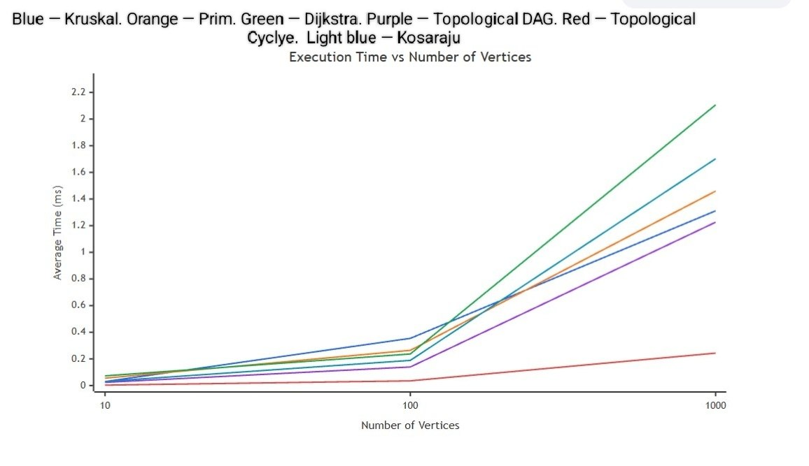
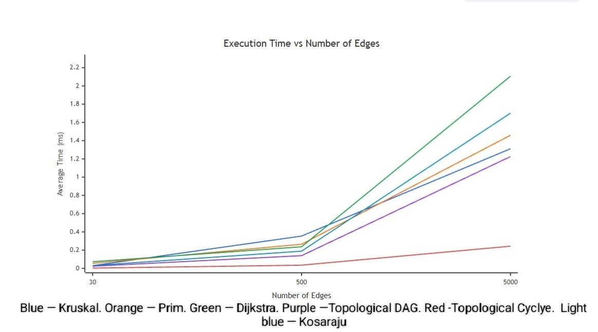

# Assignment 3 — Smart City Infrastructure and Route Planning

SE-2527 Anel Melis 

## 1. Overview

This Java project models a smart city's road network as a weighted graph. Vertices represent city districts, edges represent roads or infrastructure connections, and edge weights represent construction costs or travel distances. The application uses graph algorithms to find low-cost infrastructure networks, analyze directed connections, and calculate shortest routes. It also tests correctness and compares algorithm performance on different graph sizes.

**Technologies:** Java (JDK 25), IntelliJ IDEA, Git/GitHub. Graphs use adjacency lists; algorithm implementations use DSU, depth-first search, queues, and priority queues.

## 2. Implementation

| Component | Implementation and purpose |
|---|---|
| `graph/Edge.java` | Stores an edge's starting vertex, ending vertex, and weight. |
| `graph/Graph.java` | Adjacency-list representation for directed and undirected weighted graphs. |
| `graph/GraphGenerator.java` | Produces reproducible connected undirected graphs, DAGs, and directed graphs with cycles. |
| `dsu/DisjointSetUnion.java` | Supports `find` and `union` with path compression and union by rank. |
| `mst/Kruskal.java` | Sorts edges by weight and uses DSU to construct a minimum spanning tree (MST). |
| `mst/Prim.java` | Uses a priority queue to grow an MST from the cheapest available edge. |
| `connectivity/TopologicalSort.java` | Uses Kahn's algorithm to order DAG vertices and detect cycles. |
| `connectivity/Kosaraju.java` | Uses two DFS passes and a reversed graph to find strongly connected components (SCCs). |
| `shortestpath/Dijkstra.java` | Uses a priority queue to compute shortest distances and reconstruct paths; rejects negative edge weights. |
| `AlgorithmTests.java` | Checks algorithm correctness on normal and edge cases. |
| `ExperimentRunner.java` | Runs performance experiments and writes the results to CSV. |

Kruskal and Prim return an MST for connected graphs or a minimum spanning forest for disconnected graphs. The application reports whether the input graph is connected.

### Running the Project

Open the repository in **IntelliJ IDEA** with **JDK 25** and mark `src` as **Sources Root**. Run `Main.java` for demonstrations, `AlgorithmTests.java` for correctness checks, and `ExperimentRunner.java` to regenerate `results/tables/experimental_results.csv`. Run the experiment from the project root so the output path is correct.

## 3. Complexity Analysis

Let **V** be the number of vertices and **E** the number of edges. The graph is stored using adjacency lists; priority queues use a binary heap. Space estimates below are auxiliary space unless otherwise noted.

| Algorithm | Time complexity | Space complexity | Explanation |
|---|---|---|---|
| DSU (`find`, `union`) | Amortized **O(α(V))** per operation | **O(V)** | Path compression and union by rank keep trees shallow. |
| Kruskal | **O(E log E + E α(V))** | **O(V + E)** | Sorting edges dominates; DSU checks whether an edge creates a cycle. |
| Prim (priority queue) | **O(E log E)** | **O(V + E)** | Processes candidate edges in weight order using a binary heap. |
| Topological sorting (Kahn) | **O(V + E)** | **O(V)** | Calculates indegrees and visits each vertex and edge. |
| Kosaraju SCC | **O(V + E)** | **O(V + E)** | Two DFS passes plus construction of the reversed graph. |
| Dijkstra (priority queue) | **O((V + E) log V)** for simple graphs | **O(V + E)** | Relaxes outgoing edges and uses a binary heap; requires non-negative weights. |

The input graph itself requires **O(V + E)** storage. As the number of vertices and edges grows, MST and shortest-path methods pay additional priority-queue or sorting costs, while topological sorting and Kosaraju scale linearly with graph size.

## 4. Experimental Setup

Three graph configurations were generated using a fixed random seed of **42**, so the same graph structures and weights can be reproduced:

| Size | Vertices (V) | Edges (E) |
|---|---:|---:|
| Small | 10 | 30 |
| Medium | 100 | 500 |
| Large | 1,000 | 5,000 |

- **Kruskal, Prim, and Dijkstra:** connected undirected weighted graphs.
- **Topological-DAG:** directed graphs whose edges go from lower-numbered to higher-numbered vertices, guaranteeing no cycles.
- **Topological-Cycle and Kosaraju:** directed graphs containing a guaranteed cycle.
- Edge weights are positive integers from **1 to 100**; duplicate edges and self-loops are not generated.
- Each algorithm is warmed up once and then measured **5 times** using `System.nanoTime()`. The reported time is the average in milliseconds.
- Operation counts use algorithm-specific edge-processing counters. They are useful for tracking growth but do **not** represent identical low-level operations across algorithms.
- The runner also checks that Kruskal and Prim return the same total MST weight on generated connected graphs.

## 5. Results

The table shows **average execution time (ms) / counted operations** from the experiment run.

| Algorithm | 10 V / 30 E | 100 V / 500 E | 1,000 V / 5,000 E |
|---|---:|---:|---:|
| Kruskal | 0.030260 / 14 | 0.354360 / 164 | 1.311320 / 3,356 |
| Prim | 0.055340 / 30 | 0.264500 / 500 | 1.459440 / 5,000 |
| Dijkstra | 0.072860 / 60 | 0.237080 / 1,000 | 2.106500 / 10,000 |
| Topological-DAG | 0.024060 / 60 | 0.139580 / 1,000 | 1.225860 / 10,000 |
| Topological-Cycle | 0.003280 / 30 | 0.035360 / 500 | 0.243440 / 5,054 |
| Kosaraju | 0.031220 / 90 | 0.189040 / 1,500 | 1.701780 / 15,000 |

Full results: [`results/tables/experimental_results.csv`](results/tables/experimental_results.csv)

**Plot 1 — Execution Time vs Number of Vertices**

**Plot 2 — Execution Time vs Number of Edges**

## 6. Comparison and Discussion

Kruskal and Prim returned the same MST weight in the connected-graph checks. Their running times differed: Kruskal was faster at 10 and 1,000 vertices in this run, while Prim was faster at 100 vertices. Their performance depends on sorting, priority-queue work, and graph structure.

As graph size increased, execution times generally increased. At **1,000 vertices and 5,000 edges**, Dijkstra had the longest measured average time (**2.106500 ms**) among the six benchmark variants. Topological sorting on cyclic graphs was faster because it could terminate without processing all vertices when no zero-indegree vertex remained.

The counts reflect different types of work: Kruskal counts examined sorted edges, Prim counts extracted candidate edges, Dijkstra counts examined adjacency edges, topological sorting counts indegree and traversal work, and Kosaraju counts edge processing across its passes.

**Limitations:** Timing results vary with JVM warm-up, operating-system scheduling, and hardware. Also, vertices and edges increase together in the three configurations. Therefore, the two requested plots show performance across the same three workloads, **not** the independent effect of changing only V or only E.

## 7. Testing

`AlgorithmTests.java` performs eight automated tests. The recorded result was **8/8 PASS**:

| Test | What it checks |
|---|---|
| DSU | Union, connectivity, component count, repeated union. |
| Single Vertex | MST and shortest path for a one-vertex graph. |
| Disconnected Graph | Disconnected MST forests and unreachable paths. |
| Duplicate Weights and MST | Equal edge weights, multiple valid MSTs, and matching MST weights. |
| Topological Sort and Cycle | Valid DAG order and correct cycle detection. |
| Kosaraju SCC | Expected SCC groups and vertex coverage. |
| Dijkstra Shortest Paths | Correct distances, reconstructed paths, and unreachable vertices. |
| Dijkstra Negative Weights | Negative edges are rejected. |

The small demonstration graph also produced the same MST weight (**16**) using both Kruskal and Prim. On a separate directed shortest-path example, Dijkstra correctly reported an unreachable vertex.

## 8. Conclusion

The project demonstrates how graph algorithms can solve several Smart City problems: Kruskal and Prim plan low-cost connections, topological sorting and Kosaraju analyze directed infrastructure relationships, and Dijkstra computes shortest routes. All eight automated tests passed, and the experiments illustrate how performance changes as graph size increases. Algorithm choice depends on the network type and the planning task.
